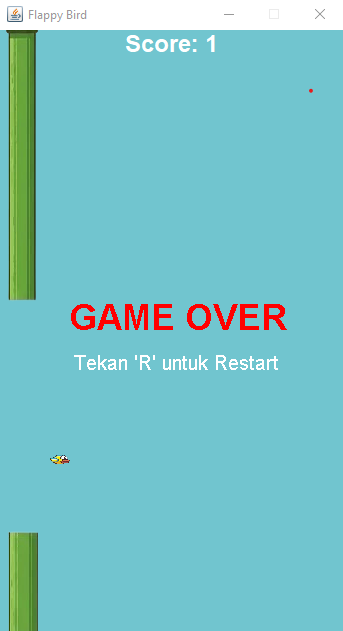
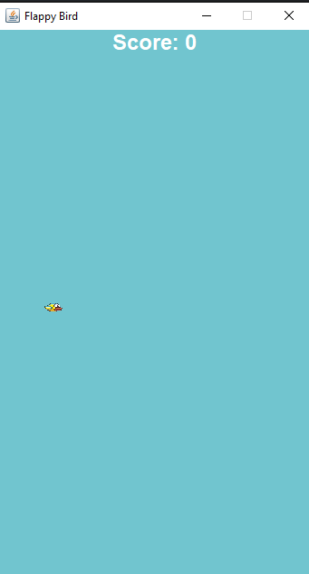
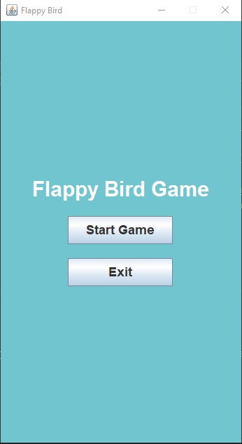

TP6DPBO2026C1 - Flappy Bird Game
Proyek ini merupakan implementasi permainan Flappy Bird menggunakan bahasa pemrograman Java dan pustaka Java Swing GUI untuk memenuhi Tugas Praktikum Mata Kuliah Desain dan Pemrograman Berbasis Objek (DPBO).

Desain Program
Program ini didesain menggunakan pola arsitektur Model-View-Controller (MVC) untuk memisahkan logika permainan, data objek, dan antarmuka tampilan.

Pada bagian Model terdapat dua kelas utama, yaitu Player dan Pipe. Kelas Player digunakan untuk menyimpan informasi tentang pemain seperti posisi koordinat x dan y, ukuran burung, kecepatan jatuh atau melompat, serta aset gambar burung. Kelas Pipe digunakan untuk menyimpan atribut rintangan berupa posisi, ukuran, status kelolosan pemain, serta aset gambar pipa atas dan bawah.

Pada bagian View terdapat dua kelas utama, yaitu MainMenu dan View. Kelas MainMenu berfungsi menampilkan layar awal permainan yang berisi tombol Start Game dan Exit. Kelas View bertindak sebagai kanvas utama (JPanel) tempat seluruh komponen grafis digambar secara real-time, seperti burung, pipa, latar belakang, teks skor, serta tampilan Game Over.

Pada bagian Controller terdapat dua kelas utama, yaitu App dan Logic. Kelas App berfungsi sebagai titik masuk utama program yang menginisialisasi jendela aplikasi (JFrame) dan menampilkan menu awal. Kelas Logic bertindak sebagai pusat kendali permainan yang mengatur timer game loop, simulasi gravitasi, pergerakan dan pemunculan pipa secara acak, pendeteksian tabrakan, perhitungan skor, serta penerimaan input dari papan ketik.

Penjelasan Alur Permainan
Saat aplikasi pertama kali dijalankan melalui file App.java, program akan membuka jendela aplikasi dan menampilkan halaman Main Menu. Pada halaman ini, pemain dapat memilih untuk memulai permainan atau keluar dari aplikasi.

Ketika pemain menekan tombol Start Game, sistem akan beralih ke tampilan permainan utama dan menjalankan game loop dengan kecepatan 60 frame per detik. Di dalam game loop ini, kelas Logic akan terus memperbarui posisi burung akibat efek gravitasi dan menggerakkan pipa-pipa rintangan ke arah kiri. Pemain dapat menekan tombol Spasi pada papan ketik untuk membuat burung melompat ke atas.

Setiap kali burung berhasil melewati sepasang pipa tanpa menabrak, skor pemain akan bertambah satu poin. Namun, jika burung menabrak pipa atas, pipa bawah, atau menyentuh batas atas dan bawah layar, permainan akan terhenti dan status berubah menjadi Game Over. Saat kondisi Game Over, pemain dapat menekan tombol R pada papan ketik untuk mereset permainan dan memulainya kembali dari awal.

Dokumentasi

 

 

